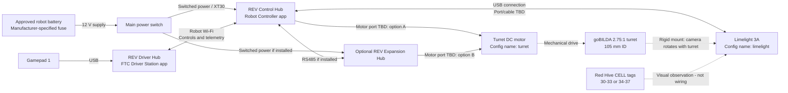
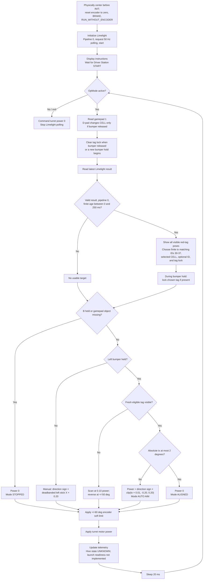

# BioBuzz AprilTag Turret: Team Implementation and Test Guide

**Team:** BioBuzz  
**Season:** FTC BIOBUZZ 2026–2027  
**Document date:** November 1, 2026  
**Source:** `TeamCode/src/main/java/org/firstinspires/ftc/teamcode/opmodes/BioBuzzAprilTagTeleOp.java`  
**Driver Station OpMode:** **BioBuzz: AprilTag Turret**

## 1. Purpose and current status

This standalone TeleOp uses a turret-mounted Limelight 3A to help the operator point the turret horizontally toward a red Hive AprilTag. It supports manual rotation, hold-to-aim assistance, and pose telemetry for field testing.

It **does not drive the chassis, control the flywheel, or feed/fire balls**. Only this OpMode runs while selected; the regular drive TeleOp does not run simultaneously.

**ALIGNED means horizontal tag alignment only. It does not mean the Hive cell is upward-facing or that the launcher is ready.** Field performance, shooting accuracy, and automatic Hive-state recognition have not been validated by this implementation.

## 2. Hardware and configuration

| Component | Configuration / requirement |
|---|---|
| Turret | goBILDA Gear-Driven Turret, 2.75:1 ratio, 105 mm ID |
| Turret drive | goBILDA 5202 Yellow Jacket, 50.9:1 (117 RPM), configured as `turret` |
| Camera | Limelight 3A configured as `limelight`, connected to the Control Hub by USB |
| Camera mounting | Rigidly attached to and rotating with the turret; pointing in the turret's aiming azimuth |
| Limelight pipeline | Pipeline **0**, configured for AprilTags |
| Tag family | **36h11** |
| Physical tag size | **3.25 inches** for accurate pose estimation; use the detector's documented size convention |
| Controls | Gamepad assigned as **gamepad 1** |

Before pressing INIT, physically center the turret and leave safe cable slack on both sides. The code resets the motor encoder at INIT, treats that location as 0°, and uses the encoder to limit all turret OpModes to approximately ±60°. The 5202 motor is specified at 1,425.1 encoder counts per motor output-shaft revolution; with the confirmed 2.75:1 reduction, this is about 10.89 counts per turret degree, or ±653 counts at ±60°. The automatic AprilTag scan reverses at ±50° (about ±544 counts), leaving a margin before the outer software limit.

The motor runs in `RUN_WITHOUT_ENCODER`; its encoder is read for position limits, not used for closed-loop motion control. Limelight polling is requested at 50 Hz; the main loop sleeps 20 ms between iterations. These settings do not guarantee a 50 Hz camera frame rate or control-loop rate. Software limits are not physical stops: they cannot protect against encoder failure, a slipping gear, a wrong gear ratio, or an incorrectly centered startup position. Verify the count-to-angle behavior at low power with the turret clear before relying on the limits.

## 3. Hive cells and tag IDs

The official BIOBUZZ manual describes two pivoting cells per Hive, with a four-tag cluster on each cell's bottom face. The tags move with the cell as the Hive tips.

| Cell location | Red IDs accepted by this OpMode | Blue IDs ignored |
|---|---|---|
| Opposite the audience | **30–33** | 42–45 |
| Audience side | **34–37** | 38–41 |

**Audience-side red tags are also Hive-cell targets**, not merely fixed navigation landmarks. Either red cell can become upward-facing. IDs 30–31 and 32–33 belong to the same four-tag cell cluster; they are not separate cell groups.

The operator must identify which cell is physically upward-facing. The software does not infer that state from tag ID, visibility, or a preset pitch threshold.

## 4. Operator controls

| Gamepad 1 input | Behavior |
|---|---|
| Left stick left/right, bumper released | Manual turret rotation, capped at 20% power and limited to approximately ±60° |
| D-pad left, bumper released | Select opposite-audience red cell: 30–33 |
| D-pad right, bumper released | Select audience-side red cell: 34–37 |
| D-pad down, bumper released | Allow both red cells: 30–37; this is the startup default |
| Hold left bumper | Sweep back and forth within approximately ±50° at 10% power; aim at a fresh eligible tag when detected |
| Release left bumper | Stop scanning and return to manual control; center the stick to stop |
| Hold B | Override manual and automatic commands with zero motor power |
| Release B | Normal control resumes; this is not a latched emergency stop |
| Driver Station STOP | End the OpMode, stop the motor, and stop Limelight polling |

Cell selection only changes with the left bumper released. `DESIRED_TAG_ID = -1` allows any tag in the selected group. A specific ID from 30–37 can instead be configured, but it must also belong to the selected group.

With both groups enabled, the first eligible detection is used—not necessarily the closest tag or the upward-facing cell. Select a particular cell for controlled tests.

## 5. Code flow and feedback control

1. Initialize the turret motor and Limelight, select pipeline 0, and start polling.
2. Show setup/control telemetry and wait for START.
3. Read gamepad input during each active loop, never in a field initializer.
4. Accept Limelight results only when they are valid, from pipeline 0, and have a finite nonnegative staleness value no greater than 250 ms.
5. Show pose telemetry for all fresh visible red tags. Filter potential aiming targets by selected cell, optional specific ID, and current tag lock.
6. Lock the first eligible tag while it is visible. If it disappears or becomes stale, resume the bounded scan; a newly detected eligible tag can then be acquired.
7. Calculate manual, scan, or aiming power; apply the encoder-based soft limit to every turret command.
8. Update telemetry. On exit, command zero power and stop Limelight polling.

### Automatic aiming

The controller uses the selected tag's horizontal angle, `tx`, in degrees. Positive `tx` places the tag to the camera's right; negative `tx` places it to the left.

Outside the ±2° tolerance, commanded power is:

$$
P = s\,\operatorname{clip}(0.01\,tx, -0.20, 0.20)
$$

Here, $s$ is `TURRET_DIRECTION_SIGN`. Within tolerance, power is zero and the mode is **ALIGNED**. While the bumper remains held, the controller resumes corrections if the error leaves the tolerance.

For example, an error of +10° requests +0.10 power with the default sign. An error of +25° is capped at +0.20. An error of +1° requests zero power.

This is proportional visual feedback, not a full PID controller or encoder-based position hold. Near the target, commanded power can become too small to overcome friction.

While the left bumper is held without a fresh eligible tag, the turret sweeps at 10% power and reverses at approximately ±50°. When a tag is found, the sweep stops and proportional visual aiming takes over. If the tag is lost, the scan resumes. Hold B to stop all turret motion. All turret OpModes also enforce the approximately ±60° encoder soft limit.

## 6. Telemetry and interpretation

| Telemetry | Meaning |
|---|---|
| Mode | `MANUAL TURRET`, `SCANNING LEFT/RIGHT`, `AUTO AIM`, `ALIGNED`, `SOFT LIMIT`, or `STOPPED` |
| Selected CELL | Eligible red tag group |
| Tag ID | Tag currently chosen for aiming |
| Horizontal aim error | Selected tag's `tx`, in degrees |
| Turret power | Commanded motor power, not measured motor movement |
| Turret angle / encoder | Estimated angle from the startup zero and current encoder count |
| Result age | Limelight result staleness in milliseconds |
| Per-tag tx / ty | Horizontal and vertical viewing angles |
| Per-tag camera XYZ | Tag position relative to the camera, displayed in inches |
| Per-tag pitch / roll / yaw | Tag orientation relative to the camera, displayed in degrees |
| Hive facing state | **UNKNOWN — verify physically** |
| Launch readiness | **NOT IMPLEMENTED — alignment only** |

Pose telemetry is shown for both visible red cells, even when one group is excluded from aiming. If pose information is unavailable, angular aiming may still work using a valid `tx`.

## 7. Upward-slanted camera mounting

An upward camera pitch helps view the tags underneath the Hive. Keep sideways camera roll near zero and secure the mount against flexing.

Record these measurements before calibration:

| Measurement | Team value |
|---|---|
| Camera pitch above horizontal (degrees) | __________ |
| Camera roll (degrees) | __________ |
| Lens-center height above tiles (inches) | __________ |
| Lens forward offset from turret pivot (inches) | __________ |
| Lens side offset from turret pivot (inches) | __________ |
| Lens vertical offset from turret pivot (inches) | __________ |
| Motor model / rated output RPM | __________ |
| Safe turret travel / cable clearance | __________ |

The current code does **not** compensate the pose telemetry for camera pitch, height, turret angle, or robot orientation. Camera-relative pitch is therefore not directly Hive tilt, and camera XYZ is not field-relative height.

Future field-relative calculations require a verified camera-to-field transformation. Changing the camera mount invalidates previous calibration. Horizontal tag centering is also not equivalent to aiming at the cell opening: tag-to-opening geometry and camera-to-launcher offsets must be considered.

## 8. Practice-field test procedure

### Driver Hub walkthrough: read values and record a tuning run

**Two different types of values:**

- **Live telemetry** (tag ID, aim error, motor command, result age, and tag pose) appears in the Driver Station app on the Driver Hub.
- **Tuning constants** (`TURN_GAIN`, power caps, tolerance, direction sign, and deadband) are defined in the Java file. The current OpMode does **not** display all of them and has **no on-hub adjustment buttons**. Use the baseline table in section 9 or the deployed source to record them. The D-pad changes the selected cell, not gains or power limits.

#### A. Connect and select the program

1. Secure the robot and make the launcher inactive. Keep one operator ready to stop and another person watching turret motion/cables.
2. Turn on the Control Hub/robot and Driver Hub. Open the **FTC Driver Station** app.
3. Confirm the Driver Station is connected to the intended Robot Controller. If it is not, use the app's menu → **Settings → Pair with Robot Controller** and select your team's controller; menu wording may vary by app version. Resolve connection/errors before testing.
4. Plug the gamepad into the Driver Hub. Assign it as **gamepad 1** using the supported controller's assignment combination (normally **Start + A**) and confirm the app shows gamepad 1 assigned. Perform assignment before the test.
5. Open the **TeleOp** selection list and choose **BioBuzz: AprilTag Turret**, not **Drive** or **Drive + Turret Test**.
6. Physically center the turret and leave cable slack on both sides. Center the left stick, release the bumper and B, then tap **INIT**. Check the setup instructions in the telemetry area and resolve any hardware-name exception. The required names are `turret` and `limelight`.
7. Confirm everyone is clear, then tap **START / ▶**. With no stick or bumper input, commanded turret power should be zero.

**Before START, this OpMode displays instructions only. It does not continuously update tag pose during INIT. Start it with neutral controls to read live tag telemetry without commanding rotation.**

#### B. Read the live telemetry

The readings appear in the main Driver Station screen's **telemetry/output area**. This is not the Settings screen. Look for these exact labels; the app layout may vary, so use the telemetry area's scrolling if available to see additional lines.

| Screen label | What to do with the reading |
|---|---|
| `Mode` | Initially expect `MANUAL TURRET`; during aiming expect `AUTO AIM` or `ALIGNED` |
| `Selected CELL` | Confirm 30–33 or 34–37 matches the physical cell you want to test |
| `Tag ID` | Record the selected aiming tag; this line is absent if no eligible fresh target exists |
| `Horizontal aim error` | Watch its absolute value decrease toward zero during auto aim |
| `Turret power` | Record the signed command; `0.10` means 10% commanded power, not RPM |
| `Result age (ms)` | Watch for values exceeding 250 ms; these results are excluded from aiming |
| `Red tag <ID> tx / ty` | Record horizontal/vertical camera angles for that specific visible red tag |
| `Red tag <ID> camera XYZ` | Record the three camera-relative position values, in inches |
| `Red tag <ID> camera pitch / roll / yaw` | Record the three camera-relative orientation values, in degrees |
| `Hive facing state` | Always `UNKNOWN` in this implementation; identify it physically |
| `Launch readiness` | Always `NOT IMPLEMENTED`; do not treat alignment as launch permission |

Fresh visible red tags produce per-tag lines even when their group is excluded from aiming. If you only see setup instructions, confirm START was pressed. If tag lines are missing, check visibility, the correct pipeline/family, and freshness. `pose: Unavailable` means the pose was not supplied; a valid horizontal angle can still be used for aiming.

#### C. Perform one controlled aiming run

1. Keep the left bumper released. Tap **D-pad left** for 30–33 or **D-pad right** for 34–37. Confirm `Selected CELL` updates. For initial tests, use one cell rather than the default both-cell mode.
2. Briefly nudge the **left stick right** to verify motor direction, then release it. Check `Turret power` returns to zero. Stop if rotation is reversed or cables approach a limit.
3. Position the selected cell's tag slightly off-center in the view. With the turret stationary, record `Tag ID`, initial `Horizontal aim error`, and `Result age (ms)`.
4. **Briefly hold the left bumper** while the observer watches the mechanism. The error magnitude should decrease. If it increases, release the bumper with the stick centered and press Driver Station **STOP / ■** before troubleshooting.
5. After direction is confirmed, hold the bumper to complete alignment. Expect **ALIGNED** and zero command within the configured ±2° tolerance. Record settling time with an external stopwatch if desired; the current code does not report settling time.
6. Release the bumper and keep the stick centered. For an override test, hold **B** and confirm `STOPPED` and zero command. Release the bumper and center the stick before releasing B; otherwise movement can resume.
7. Check target loss separately: during a brief bumper hold, make the tag unavailable from outside the robot's motion area. Expect the bounded scan to resume. Do not put hands near the mechanism or unplug powered hardware.
8. Tap **STOP / ■** to finish the run. Record actual observations, not just expected behavior.

**Example reading:** `Tag ID: 30`, `Horizontal aim error: +10.0 deg`, and `Turret power: +0.10` is consistent with auto aiming at the baseline gain/sign. After centering, an error of `+1.0 deg` should show `ALIGNED` with `0.00` power. These are illustrative values, not measurements from your robot.

#### D. Record Hive-pose readings without turret motion

1. START the OpMode with the left stick centered and bumper released. Keep the robot/turret still, or hold B for a zero-command override while reading.
2. Note whether the 30–33 cell or the 34–37 cell physically faces upward.
3. Record each visible tag's `tx / ty`, `camera XYZ`, and `camera pitch / roll / yaw` in the section 10 test table. Include measured camera mounting and robot location/orientation.
4. Use the Driver Hub's screenshot function, or have a teammate transcribe values while stationary. Do not hold a phone near moving gears. Use screenshots to document observations; they are not an automatic telemetry log.
5. On your practice field, repeat in the other stable Hive position using authorized handling procedures, then repeat at several viewing locations. Do not move or tip the Hive manually during a competition MATCH.

#### E. Change a tuning setting and rerun

1. Tap **STOP** before making changes.
2. On the programming computer, open `BioBuzzAprilTagTeleOp.java`. Change **one** constant, for example `TURN_GAIN`, following section 9. Record old/new values and a build/source version.
3. Build/install the updated Robot Controller app to the **Control Hub**, not the Driver Hub. Use the team's Android Studio/deployment workflow. Saving the Java file alone does not update the robot.
4. Reconnect if necessary, select the same OpMode, INIT, and START with neutral controls. Repeat the same test conditions to compare results.
5. Limelight exposure/gain and pipeline settings are configured separately through the **Limelight web interface** on your setup computer. They are not adjusted by the D-pad or shown by the current telemetry. Record those settings alongside the code constants.
6. Do not adjust hardware or deploy software during a MATCH. Test in a permitted practice area and follow event network/calibration restrictions.

### Preparation

- Secure the robot and isolate the launcher/feeder. Keep people clear of the turret gears and moving mechanism.
- Center the turret and verify safe cable slack in both directions. Confirm `turret`, `limelight`, pipeline 0, family 36h11, and tag-size configuration.
- Build/install the updated Robot Controller app. Select **BioBuzz: AprilTag Turret**.
- Confirm camera detection before motion. Use authorized practice-field handling procedures.

### Direction and aiming

1. With the turret physically centered, press INIT and confirm the encoder angle is near 0°. Then press START with the stick centered and bumper released.
2. Briefly nudge the left stick right at low power. Confirm the encoder value changes and that the turret moves freely; verify the direction sign for camera aiming.
3. If visual aiming is reversed, STOP, change `TURRET_DIRECTION_SIGN` to `-1.0`, rebuild/install, and retest.
4. Select one red cell with the D-pad. Position its tag slightly off-center in view.
5. Hold the bumper briefly. The turret should scan only within the marked safe arc; when the selected tag appears, the magnitude of horizontal error should decrease. Stop immediately if motion is unexpected or cables become taut.
6. Continue holding only after the direction and arc are verified. Verify **ALIGNED** and zero power within ±2°.
7. Hold B to verify the override. Center the stick and release the bumper before releasing B.
8. From outside the robot's motion area, make the tag unavailable. The scan should resume but remain within its configured arc. Do not put hands near the mechanism.
9. Present only a blue tag or a red tag from the excluded cell. The turret should continue bounded scanning without aiming at it.

### Hive-state data collection — no launching

1. Keep the robot and turret stationary and observe both stable Hive positions on the practice field.
2. Record the visible tag IDs, pose telemetry, and which cell opening physically faces upward.
3. Repeat at multiple distances, robot headings, and turret angles.
4. After a tip, release the bumper, select the newly upward-facing cell, and test horizontal aiming again.
5. Do not infer upward-facing state from a single uncalibrated camera-pitch value.

During a competition MATCH, do not manually manipulate the Hive. Event measurement/calibration periods also have their own restrictions, including no launching; follow the current manual and event staff instructions.

## 9. Tuning checklist

Change one setting at a time, record the result, and retest under representative lighting and mechanical load.

| Setting | Current baseline | Tuning guidance |
|---|---:|---|
| `TURRET_DIRECTION_SIGN` | 1.0 | Verify direction first; reverse if the motor turns away from the target |
| `TURN_GAIN` | 0.01 | Reduce for overshoot/hunting; increase cautiously if response is too slow |
| `MAX_AUTO_POWER` | 0.20 | Keep low initially; check wiring/binding before increasing |
| `MANUAL_POWER` | 0.20 | Set a controllable manual speed appropriate to the mechanism |
| `AIM_TOLERANCE_DEGREES` | 2.0 | Tighten only after stable tracking; account for vision noise and backlash |
| `DEADBAND` | 0.08 | Suppresses manual stick drift only |
| `MAX_RESULT_AGE_MS` | 250 | Do not increase merely to conceal unreliable vision or communications |
| Limelight exposure/gain | Record camera settings | Reduce motion blur while maintaining adequate brightness; excessive gain adds noise |

Upward camera pitch alone does not require a gain or gear-ratio change. Check both stable Hive positions, several initial horizontal errors, and multiple distances after tuning.

### Troubleshooting

| Observation | Check |
|---|---|
| No eligible target | Pipeline/family, visibility, lighting, selected group, optional specific ID, result age |
| Error increases during aiming | Motor direction sign, camera mounting/orientation; stop before retesting |
| Nonzero power but no motion | Correct motor port, wiring, binding, friction, and mechanical load |
| Stops outside the aim tolerance | Small proportional command may not overcome friction; review tuning, not just tolerance |
| Repeated oscillation | Gain, backlash, camera noise, exposure, latency, and mount flex |
| Pose changes when turret turns | Expected: pose is camera-relative, not a fixed field coordinate |

## 10. Test records

Leave results blank until measured. Record screenshots or logs where possible.

| Date / tester | Upward-facing cell | Visible tag ID | Distance / robot heading / turret angle | tx / ty | XYZ (in) | Pitch / roll / yaw (deg) | Mount/settings version | Notes |
|---|---|---|---|---|---|---|---|---|
| | | | | | | | | |
| | | | | | | | | |

| Test | Expected result | Actual result / evidence | Pass / fail |
|---|---|---|---|
| Manual direction | Moving the left joystick right rotates the turret right | | |
| Auto correction | Absolute horizontal error decreases | | |
| Alignment | Zero command within configured tolerance | | |
| B override | Zero motor command while B is held | | |
| Lost/stale target | Bounded scan resumes within +/-50 deg | | |
| Wrong alliance / excluded cell | Not selected for aiming | | |
| Hold lock | Keeps the selected tag while visible; reacquires an eligible tag after loss | | |
| Both Hive positions | Pose recorded and physical upward-facing cell identified | | |
| OpMode exit | Turret power zero and Limelight polling stopped | | |

## 11. Limitations and next development steps

- Encoder-based soft travel limits are implemented, but there are no physical stops, limit switches, automatic homing, or cable-twist protection. Limits depend on the operator centering the turret before INIT and the encoder/gearing assumptions being correct. BRAKE does not guarantee precise holding.
- A missing gamepad object defaults to stopped control, but the code has no dedicated controller-disconnection watchdog.
- The staleness threshold does not guarantee end-to-end capture-to-motor latency; camera processing and communication delay also affect tracking.
- No automatic upward-facing-cell classifier or motion/settling detector is implemented.
- Individual tag centers are different aiming points; the code does not combine the cluster into a cell-opening target.
- Future shooting assistance needs calibrated cell pose, tag-to-opening geometry, camera-to-launcher offsets, turret angle feedback as needed, launcher elevation, measured flywheel speed, and a tested distance-to-shot-settings table.
- Autonomous firing or launch permission must not be inferred solely from **ALIGNED**.

**Validation status:** Editor diagnostics were clear during development. Successful full Android compilation and real-robot performance have not been established in this session. The team should fill the test records before presenting performance claims.

## 12. Official references

- [BIOBUZZ competition manual HTML, TU07](https://ftc-resources.firstinspires.org/ftc/game/cm-html): sections **9.6** (Hive), **9.9** (AprilTags), **10.5.1** (Hive scoring), **G417** (Hive interaction), and **T405** (field calibration restrictions).
- [Official game and season materials](https://ftc-resources.firstinspires.org/ftc/game): use the latest English PDF/manual updates as authoritative.
- [BIOBUZZ playing-field resources](https://ftc-resources.firstinspires.org/ftc/archive/2027/field): field CAD, setup guides, and printable AprilTags.

Exact tag-to-opening offsets and changing field-relative heights must be verified from field CAD or authorized measurements. The frame pivot height is not the tag-center height.

**Documentation attribution:** This draft was prepared with GitHub Copilot assistance. Team members should review it against the robot and record their own measurements, tuning decisions, and results. Follow the current manual's attribution requirements if incorporating it into a team portfolio.

## 13. Wiring, control-flow, and sequence diagrams

These diagrams describe the current turret-only test. **TBD means the team must verify and fill in the actual connection.** The wiring diagram is a logical connection guide, not a pin-level schematic or confirmation of the robot's installed wiring.

### A. Logical wiring and mechanical feedback



**Wiring notes**

- Use **one** motor connection: Control Hub option A **or** Expansion Hub option B, not both. Verify the port mapped to `turret` in the active Robot Controller configuration.
- The optional Expansion Hub must have manufacturer-approved power and RS485 connections if used. Omit it from the team wiring record if not installed.
- The Limelight link shown is its USB connection to the Control Hub; verify its cable and power requirements against the manufacturer's instructions. Do not interpret the diagram as permission to connect battery voltage to USB or sensor pins.
- Connect the gamepad to the Driver Hub, not the Control Hub. The Driver Hub does not directly power or command the turret motor.
- Dotted arrows represent mechanical mounting or optical feedback, not electrical wires. Provide cable strain relief and sufficient slack throughout the permitted turret travel.
- The motor's integrated encoder must be connected and reporting valid counts through the motor port. No limit switches or physical stops are used; the software limit depends on the centered startup reference and the stated motor/turret gearing.
- Power off the robot before changing wiring. Use approved fusing, connectors, wire sizing, and power distribution; never connect the motor directly to the battery for this control setup.

| Connection to verify | Team-installed value |
|---|---|
| Turret motor hub (Control or Expansion) | TBD |
| Turret motor port (0–3) | TBD |
| Motor model and connector | TBD |
| Limelight Control Hub USB port/cable | TBD |
| Expansion Hub installed and powered? | TBD |
| Additional approved power devices, if any | TBD |
| Cable clearance / permitted turret travel | TBD |

### B. Turret-control flowchart



The diagram shows normal runtime decisions and exit cleanup. Hardware initialization errors can prevent START; they must be resolved before testing. B overrides motor output but does not stop vision telemetry. Losing a tag resumes scanning; another eligible tag can be acquired during the same bumper hold.

### C. Operator-to-motor sequence diagram

```mermaid
sequenceDiagram
	actor Operator
	participant DS as Driver Hub / Driver Station
	participant OP as BioBuzzAprilTagTeleOp
	participant LL as Limelight 3A
	participant HUB as Configured motor hub
	participant T as Turret and mounted camera

	Operator->>DS: Center turret, then select BioBuzz: AprilTag Turret; INIT
	DS->>OP: Initialize OpMode
	OP->>HUB: Power 0; BRAKE; reset encoder; RUN_WITHOUT_ENCODER
	OP->>LL: pipelineSwitch(0); setPollRateHz(50); start()
	OP-->>DS: Setup instructions
	Note over LL,OP: Limelight polling runs independently.<br/>getLatestResult reads the latest cached result.
	Operator->>DS: START with neutral controls
	DS->>OP: Start active loop

	loop While OpMode is active
		Operator->>DS: Gamepad 1 buttons and stick input
		DS-->>OP: Updated gamepad state
		opt Bumper released and D-pad used
			OP->>OP: Select 30-33, 34-37, or both
		end
		OP->>LL: getLatestResult()
		LL-->>OP: Latest result, validity, age, tag data
		OP->>OP: Check freshness and IDs; collect pose telemetry
		opt Aim bumper held and eligible tag exists
			OP->>OP: Lock selected tag while visible
		end
		alt B held or gamepad object missing
			OP->>OP: Select zero power
		else Bumper released
			OP->>OP: Calculate manual stick command
		else Bumper held but no fresh eligible target
			OP->>OP: Sweep and reverse at +/-50 degrees
			OP->>OP: Select scan command
		else Bumper held and absolute tx within 2 degrees
			OP->>OP: Select zero power; mode ALIGNED
		else Bumper held and target outside tolerance
			OP->>OP: Compute signed proportional power, capped at 20 percent
			OP->>OP: Select aim command
		end
		OP->>OP: Apply +/-60 degree encoder soft limit
		OP->>HUB: setPower(limited command)
		HUB->>T: Apply motor output
		Note over T,LL: If the mechanism moves, the camera moves with it;<br/>the next camera frame provides new visual error.
		OP-->>DS: Mode, target, tx, pose, result age, power
		DS-->>Operator: Display live telemetry
		OP->>OP: Sleep 20 ms
	end

	Operator->>DS: STOP
	DS->>OP: End OpMode
	OP->>HUB: setPower(0) in cleanup
	OP->>LL: stop()
	Note over OP,T: No chassis driving or launcher firing is commanded.
```

### Viewing and exporting

Open this guide in VS Code and press **Ctrl+Shift+V** for Markdown preview. Mermaid rendering depends on the preview's Mermaid support; if the diagrams appear as text, use a trusted Mermaid-capable preview/export tool. For team submissions, export to PDF or SVG using an approved tool and visually check labels, arrows, page breaks, and the unresolved wiring fields before sharing.